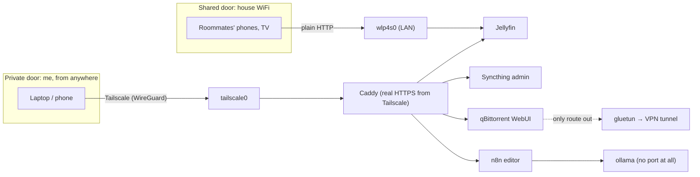

# homeserver

The configuration for **homie**, an old ThinkPad T470 (i5-7300U, 7 GiB RAM) that runs headless
on Ubuntu Server as my home server. Seven Docker services handle media streaming, file sync, a
VPN-sealed download client, automation and a local language model. No ports are open on the
router.

This repo *is* the server: a clean Ubuntu install, Docker, Tailscale and one checkout of this
repo bring it back. Runtime state and secrets (`config/`, `.env`) are gitignored and covered by
the nightly backup instead.

> Hostnames, tailnet names and IP addresses in this copy are placeholders.

## Two doors

One rule shapes every service: **roommates get media and nothing else.** That is enforced by
which network interface each port listens on, not by a firewall.



Docker writes its own iptables rules ahead of ufw's, so a published port is reachable from the
whole network while `ufw status` claims everything is denied. Every port is therefore pinned to
an address in [`docker-compose.yml`](docker-compose.yml) using one of four patterns, written at
the top of that file:

| Pattern | Written as | Used for |
|---|---|---|
| Tailnet only | `"${TAILNET_IP}:PORT:PORT"` | Admin UIs and Caddy's listeners |
| LAN | `"PORT:PORT"` | Jellyfin (8096), Syncthing's sync protocol |
| Localhost only | `"127.0.0.1:PORT:PORT"` | These docs, reached through an SSH tunnel |
| No port | *(none)* | n8n and ollama, reached by container name only |

[`bin/homie-check`](bin/homie-check) re-tests every port from both sides on each run.

## Services

| Service | What it does | Memory cap |
|---|---|---|
| Jellyfin | Media streaming with Intel Quick Sync hardware transcoding | 2 GB |
| Syncthing | School/work files across my own devices, 365-day versioning | 512 MB |
| Caddy | Reverse proxy; certificates come from Tailscale, so no ACME and no port 80 | 256 MB |
| gluetun | Owns a network namespace whose only way out is a WireGuard VPN tunnel | 256 MB |
| qBittorrent | Download client, living inside gluetun's namespace | 1 GB |
| n8n | Automation, starting with syncing Canvas deadlines into Google Calendar | 1.5 GB |
| ollama | Local 3B language model, CPU only, unloaded after every request | 3 GB, 3 CPUs |

Every image is pinned to an exact tag. Upgrading is: bump the tag, `docker compose up -d
<service>`, verify, commit. Rolling back is reverting the commit.

## Decisions worth explaining

- **The VPN kill switch is structural.** qBittorrent has no network namespace of its own
  (`network_mode: service:gluetun`). If the tunnel goes down it has no interface at all, so it
  can't fall back to the home connection. Everything else on the box uses the normal
  connection, which a host-level VPN client would have broken.
- **Memory ceilings everywhere.** With 7 GiB and four threads, no service may starve a
  transcode. Each limit is sized from measured usage, and Node's heap is capped below n8n's
  limit so it garbage-collects instead of being OOM-killed.
- **Loud failures over silent ones.** Bind mounts use `create_host_path: false`, so an unplugged
  external drive stops the containers instead of handing them empty folders. Docker's default
  would have made Jellyfin think the library had been deleted.
- **Moves are renames.** Downloads and the library share one bind mount, because `rename(2)`
  fails across mount points and Python's `shutil.move` silently falls back to copying.
  Filing one episode dropped from 30 minutes to instant.
- **Backups snapshot live databases** through SQLite's online backup API instead of copying
  files mid-write, and every archive is verified after it's written.

The full reasoning is in the explainer pages in [`docs/`](docs/). Open them in a browser:
[architecture](docs/architecture.html), [networking](docs/networking.html),
[wiring diagram](docs/wiring-diagram.html), [operating manual](docs/operating-manual.html).

## Scripts

| Script | What it does |
|---|---|
| [`bin/homie-check`](bin/homie-check) | Health check: containers, port exposure tested from both sides, VPN egress IP vs home IP, library and disk |
| [`bin/homie-backup`](bin/homie-backup) | Nightly backup (systemd timer): rsync mirror plus a verified, rotated config archive with database snapshots |
| [`bin/homie-automation-check`](bin/homie-automation-check) | Dead man's switch: runs outside n8n and reads its state database directly, so a dead n8n can't hide its own failure; emails when anything is stale |
| [`hooks/qbt-file`](hooks/qbt-file) | Runs when a download finishes: parses the release name, files it into the library with Jellyfin's naming, and never overwrites |
| [`bin/qbt-why`](bin/qbt-why) | Dry-runs the filing hook with debug logging to explain a decision |
| [`bin/addmedia`](bin/addmedia) | Files a media file by hand with the same naming rules |
| [`bin/wf-preview`](bin/wf-preview), [`bin/canvas-preview`](bin/canvas-preview) | Run n8n workflow code locally against test fixtures, without credentials |
| [`bin/homie-docs`](bin/homie-docs) | Renders the docs as text in a terminal over SSH |

## Layout

```
docker-compose.yml   every service, with the reasoning for each setting beside it
caddy/Caddyfile      reverse proxy, one port per service on the tailnet hostname
bin/                 operations scripts (Bash and Python, standard library only)
hooks/               qBittorrent's "on finished" filing hook and its title overrides
systemd/             timers for the backup and the automation check
workflows/           n8n workflow JSON (n8n keeps workflows in its database otherwise)
tests/fixtures/      sample data for dry-running workflows
docs/                explainer pages: architecture, networking, wiring, operating manual
.env.example         every variable the stack reads; copy to .env and fill in
```

## Setting it up

```bash
git clone <this repo> ~/homeserver && cd ~/homeserver
cp .env.example .env            # fill in PUID/PGID, TAILNET_IP, secrets
docker compose up -d
sudo cp systemd/* /etc/systemd/system/ && sudo systemctl daemon-reload
sudo systemctl enable --now homie-backup.timer homie-automation-check.timer
bin/homie-check
```

It expects Tailscale on the host, an external drive mounted at `/mnt/t7` for media and backups,
and the user and paths in the systemd units adjusted to match.
